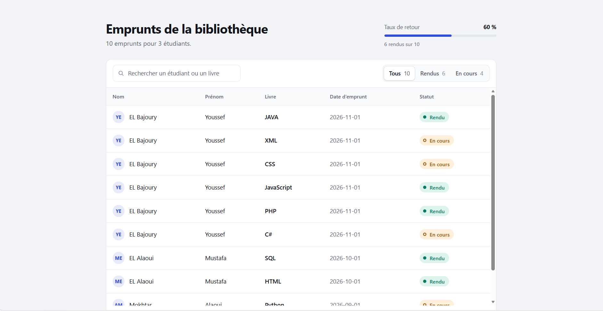
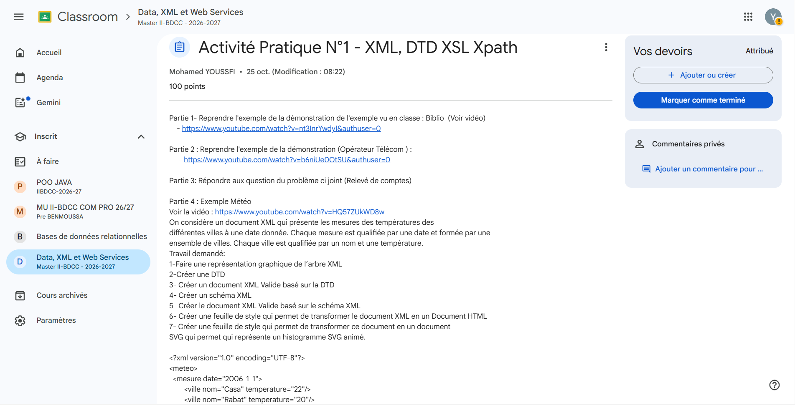

<div align="center">

# 📚 XML & XSLT Enterprise Library Management System

[](biblio.dtd)
[](S2_biblio.xsl)
[](https://code.visualstudio.com/)

*A robust, well-structured academic project demonstrating advanced document structuring, schema validation, and responsive XML-to-HTML transformation using modern CSS.*

</div>

---

## 🧭 Overview

This repository contains a full-stack data representation project developed for the **Data, XML et Web Services** module (**II-BDCC**). The system manages a structured database of library loans, mapping relationships between students and books while ensuring strict data integrity and delivering a high-end web presentation layer.

### Core Architectural Layers:
1. **Schema Definition (`biblio.dtd`)**: Enforces structural constraints, element hierarchies, and required attributes.
2. **Data Corpus (`S2_biblio.xml`)**: Stores validated hierarchical records of students and their corresponding book loans.
3. **Presentation & Styling (`S2_biblio.xsl` & CSS)**: Transforms raw XML nodes into a responsive, modern HTML5 dashboard featuring custom micro-animations and status badges.

---

## 🛠️ Project Structure

```text
📦 II-BDCC-Library-Management
 ┣ 📂 images
 ┃ ┣ 📜 Bibliotheque_Capture.png     # XML/XSLT Rendered Dashboard preview
 ┃ ┗ 📜 ClassRoomTP_Capteur.png      # Classroom environment / TP setup preview
 ┣ 📜 biblio.dtd                     # Document Type Definition schema
 ┣ 📜 S2_biblio.xml                  # Main XML data instance
 ┣ 📜 S2_biblio.xsl                  # XSLT transformation stylesheet
 ┗ 📜 README.md                      # Project Documentation
```

---

## 📐 Technical Specifications & Schema Rules

### 1. Document Type Definition (`biblio.dtd`)
The schema enforces strict relational integrity:
* **Root Element:** `<biblio>` containing one or more `<etudiant>` elements (`etudiant+`).
* **Entity Hierarchy:** Each `<etudiant>` holds one or more `<livre>` elements (`livre+`).
* **Attributes & Constraints:**
  * `etudiant`: `#REQUIRED` attributes for `id`, `nom`, `prenom`, and `age`.
  * `livre`: `#REQUIRED` attributes for `id`, `titre`, and `dateempre`. The loan status attribute `rendue` uses an enumerated type `(oui|non)` with a default value of `"non"`.

### 2. Modern XSLT Transformation & UI Design (`S2_biblio.xsl`)
The custom XSL stylesheet utilizes XPath node traversal (`../@attr`) to flatten relational hierarchies into a clean table structure, enhanced with:
* **Glassmorphic & Clean Aesthetics:** Built with a custom design system (`:root` CSS variables, Inter font-stack).
* **Interactive Micro-Interactions:** Smooth row scaling (`scale(1.01)`), shadow elevation, and transitions on hover.
* **Conditional Styling (`<xsl:choose>`):** Dynamic badges indicating book return status (`Rendu` in emerald green vs. `Non rendu` in coral red).

---

## 🖼️ Visual Showcase & Results

### 1. Rendered XML / XSLT Dashboard Output
*The dynamic, responsive HTML dashboard generated via XSLT transformation:*

```html
<!-- Insert your screenshot here once pushed to GitHub -->
<div align="center">
  
</div>
```

### 2. Classroom Practical Work (TP) Environment
*Overview of the development environment and configuration setup:*

```html
<!-- Insert your screenshot here once pushed to GitHub -->
<div align="center">
  
</div>
```

---

## 🚀 Getting Started & Local Setup

To run or review this project locally using **Visual Studio Code**:

1. **Clone or Download** this repository into your workspace.
2. Ensure both files (`S2_biblio.xml` and `S2_biblio.xsl`) are in the **same directory root**.
3. Install the **Live Server** extension in VS Code.
4. Open the project folder in VS Code, right-click `S2_biblio.xml`, and select **"Open with Live Server"** to view the rendered dashboard in your default browser.

---

## 👨‍💻 Author

* **Youssef EL BAJOURY**
* *Cycle d'Ingénieur - II-BDCC*