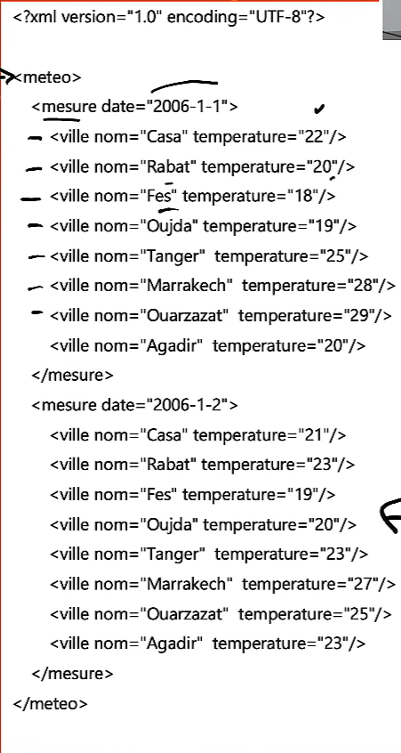
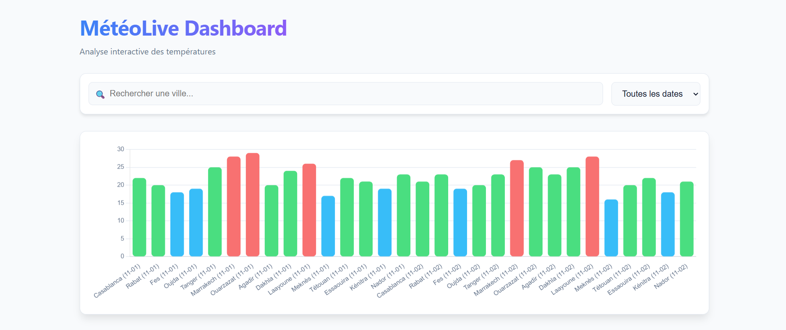
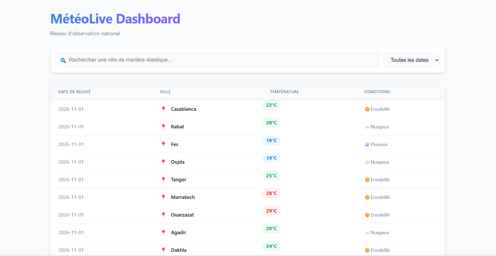

# 🌤️ MétéoLive Dashboard

[](#)
[](#)
[](#)
[](#)

An enterprise-grade, interactive weather analytics dashboard built by transforming raw XML data into a dynamic HTML5 Single Page Application (SPA) using **XSLT**. 

This project demonstrates advanced XML processing combined with modern frontend technologies, featuring real-time DOM manipulation, dynamic charting, and a responsive, accessible user interface.

---

## ✨ Key Features

* **Dynamic Data Transformation**: Utilizes XSLT 1.0 to seamlessly parse and render structured XML weather measurements into a robust HTML structure.
* **Interactive Data Visualization**: Integrates `Chart.js` for dynamic, real-time bar charts that automatically update based on the currently filtered dataset.
* **Advanced Filtering Engine**: 
  * Diacritic-agnostic search bar for cities (e.g., matching "É" to "e").
  * Dropdown filtering by specific measurement dates.
* **Smart Data Table**:
  * Multi-type column sorting (alphabetical and numerical).
  * Conditional formatting via CSS for temperature badges (Cold/Mild/Hot).
  * Dynamic Empty States when no data matches search criteria.
* **Modern UI/UX Architecture**:
  * Native CSS Variables with a polished Dark Mode default (and Light mode support via `prefers-color-scheme`).
  * Smooth CSS transitions and table row entry animations.

---

## 📸 Previews

### Exercise Overview


### Dashboard - Graphical Analytics


### Dashboard - Tabular Data


---

## 🛠️ Technology Stack

* **Data Layer**: XML
* **Transformation**: XSLT 1.0, XPath
* **Frontend**: HTML5, Vanilla JavaScript (ES6+), CSS3
* **Visualization**: Chart.js (via CDN)

---

## 📂 Project Structure

```text
├── images/
│   ├── S2_Meteo_Exercice.png
│   ├── S2_Meteo_Graph_Dashboard.png
│   └── S2_Meteo_Table_Dashboard.png
├── data.xml          # The source XML file containing weather data (to be created/linked)
├── style.xsl         # The main XSLT stylesheet (provided code)
└── README.md         # Project documentation