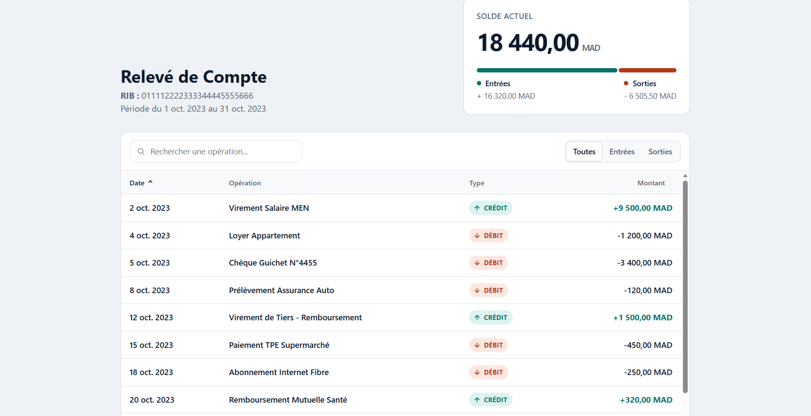
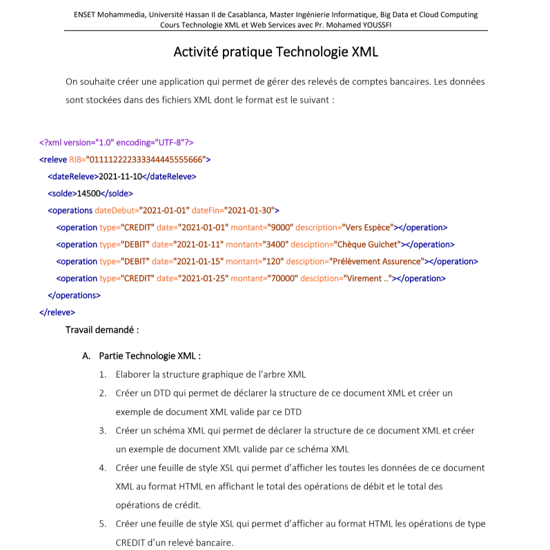

# 🏦 Relevé de Compte Bancaire (RCB) - Interactive XML/XSLT Dashboard


## 📖 Vue d'ensemble
Ce projet est une implémentation avancée de la structuration et de la transformation de données bancaires. Il transforme un simple fichier de données (XML) validé par une structure stricte (DTD) en un tableau de bord analytique interactif, moderne et responsive grâce à XSLT et JavaScript.

## ✨ Fonctionnalités Principales
- **Architecture Robuste** : Données structurées en XML et validées par un fichier DTD rigoureux.
- **Tableau de Bord Analytique** : Calcul automatique des totaux (entrées/sorties), pourcentages et barre de répartition visuelle.
- **Expérience Utilisateur (UX) Premium** : 
  - Support natif du **Dark Mode** et Light Mode.
  - Interface responsive adaptée aux mobiles et aux écrans larges.
  - Design system moderne (badges, puces, formatage typographique des montants et dates).
- **Interactivité Temps Réel** (Progressive Enhancement) :
  - Barre de recherche instantanée.
  - Filtres dynamiques par type d'opération (Crédit / Débit).
  - Tri dynamique ascendant/descendant sur l'ensemble des colonnes du tableau.

## 📸 Aperçus du Projet

### Interface du Tableau de Bord


### Contexte de l'Exercice


## 📂 Structure du Projet

L'arborescence du projet est organisée de la manière suivante :

```text
S2_RCB/
├── images/
│   ├── S2_RCB_Dashboard.png     # Capture d'écran du rendu final
│   └── S2_RSB_exercice.png      # Énoncé original de l'exercice
├── README.md                    # Documentation du projet
├── S2_RCB.dtd                   # Document Type Definition (Règles de validation)
├── S2_RCB.xml                   # Données du relevé bancaire (Lié au DTD et XSL)
└── S2_RCB.xsl                   # Feuille de style de transformation (UI, CSS, JS)