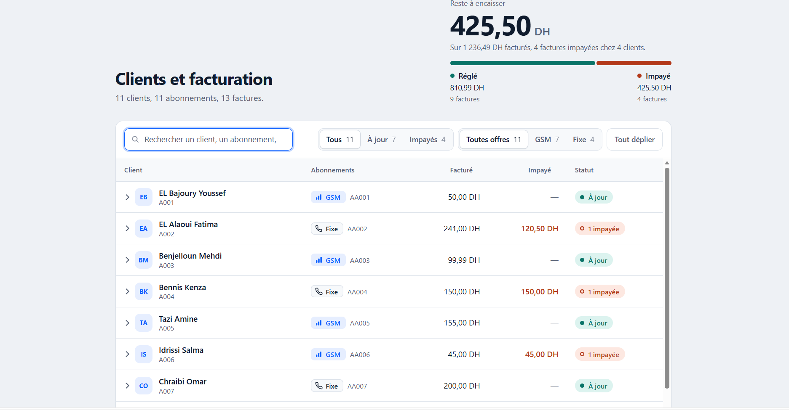
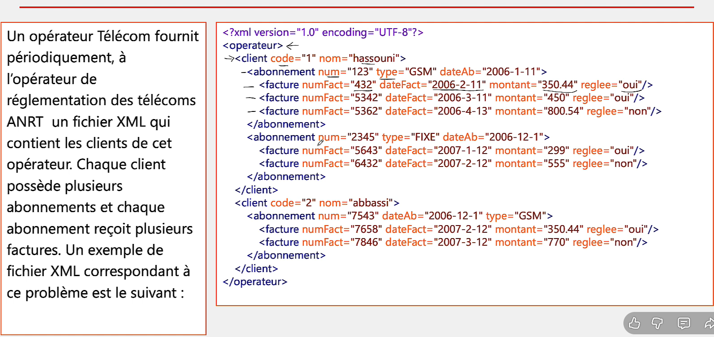

# 📡 Enterprise Telecom Billing & Subscription Management System

*An advanced academic data integration and transformation project demonstrating rigorous schema validation, hierarchical XML structuring, and professional XSLT-to-HTML UI styling.*

## 🧭 Overview

This repository contains a full-stack data representation project developed as part of the **Data, XML et Web Services** curriculum (**II-BDCC**). The system models a telecommunications operator database, mapping relational hierarchies between customers, their service subscriptions (GSM/FIXE), and associated billing records while ensuring strict schema compliance and delivering an executive-level presentation layer.

### Core Architecture Layers:

1. **Schema Validation (`S2_Telecom.dtd`)**: Defines strict structural constraints, element nesting hierarchies (`operateur` $\rightarrow$ `client` $\rightarrow$ `abonnement` $\rightarrow$ `facture`), and attribute rules.

2. **Data Corpus (`S2_Telecom.xml`)**: Houses structured, validated operational records for diverse clients, subscriptions, and invoices.

3. **Presentation & Styling (`S2_Telecom.xsl`)**: Transforms raw XML documents on-the-fly into a responsive, modern HTML5 management dashboard featuring CSS variables, status badges, and hover animations.

---

## 🛠️ Project File Structure

```
📦 II-BDCC-Telecom-Management
 ┣ 📂 images
 ┃ ┣ 📜 S2_Telecom_Dashboard.png     # Rendered XSLT/HTML dashboard preview
 ┃ ┗ 📜 S2_Telecom_Exercice.png      # Practical work (TP) schema / code view
 ┣ 📜 S2_Telecom.dtd                 # Document Type Definition schema
 ┣ 📜 S2_Telecom.xml                 # Main XML structured data instance
 ┣ 📜 S2_Telecom.xsl                 # XSLT transformation & CSS styling sheet
 ┗ 📜 README.md                      # Project Documentation
```

---

## 📐 Technical Specifications & DTD Constraints

### Document Type Definition (`S2_Telecom.dtd`)
The schema strictly enforces relational integrity across four hierarchy levels:
* **Root Element:** `<operateur>` containing one or more `<client>` records (`client+`).
* **Client Node:** Each client holds one or more `<abonnement>` elements (`abonnement+`).
* **Subscription Node:** Each subscription contains one or more `<facture>` elements (`facture+`).
* **Facture Node:** Represented as an empty element (`EMPTY`) relying entirely on robust attributes:
  * `client`: `#REQUIRED` attributes `code` and `nom`.
  * `abonnement`: `#REQUIRED` attributes `num` and `dateAb`, with an enumerated `type` (`GSM | FIXE`) defaulting to `"GSM"`.
  * `facture`: `#REQUIRED` attributes `numFact`, `dateFact`, and `montant`, with a payment status attribute `reglee` using an enumeration `(oui|non)` defaulting to `"oui"`.

---

## 🖼️ Visual Showcase & Execution Results

### 1. Rendered XML / XSLT Dashboard Output
*The dynamic, responsive HTML dashboard generated via browser-side XSLT transformation:*

```html
<div align="center">
  
</div>
```

### 2. Practical Work (TP) & Development Environment
*Overview of the workspace configuration and schema structure in the IDE:*

```html
<div align="center">
  
</div>
```

---

## 🚀 Getting Started & Local Setup

To run and preview this project locally using **Visual Studio Code**:

1. **Clone or Download** this repository into your local workspace.
2. Ensure that `S2_Telecom.xml`, `S2_Telecom.xsl`, and `S2_Telecom.dtd` reside in the **same directory root**.
3. Install the **Live Server** extension by Ritwick Dey in VS Code.
4. Right-click `S2_Telecom.xml` and select **"Open with Live Server"** to render the fully styled dashboard in your default web browser.

---

## 👨‍💻 Author

* **Youssef EL BAJOURY**
* *Cycle d'Ingénieur - II-BDCC*